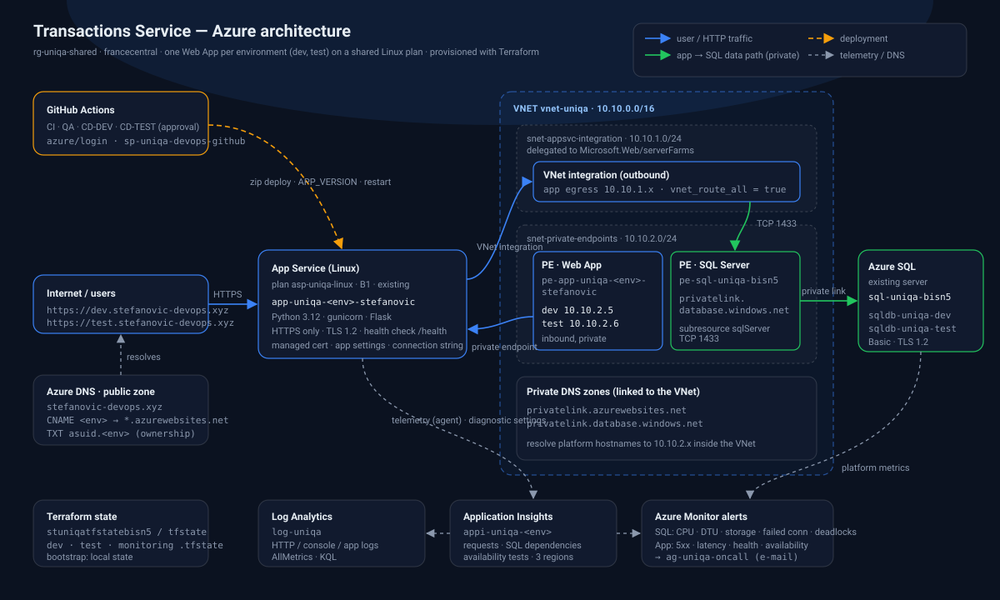

# UNIQA / SEE Digital — DevOps Engineer Assignment

A Flask "Transactions Service" deployed to Azure App Service on an **existing** Linux plan, wired
into a VNet with a private endpoint and a custom domain, provisioned end to end with Terraform,
delivered by four GitHub Actions pipelines (CI → QA → CD-DEV → approved CD-TEST), and monitored
together with the **existing** SQL Server it uses.



## Requirement mapping

| Assignment requirement | Where | Status | What's inside |
|---|---|---|---|
| App Service Creation | [infrastructure/terraform/](infrastructure/terraform/) | ✅ | Web App on the existing `asp-uniqa-linux`; Application Settings, Connection Strings, Custom Domain, Private Endpoint, VNet Integration — see the [component map](docs/03-application-infrastructure.md#5-assignment-component--terraform) |
| CI Process | [pipelines/ci.yml](pipelines/ci.yml) | ✅ | flake8 · black · bandit · pytest/coverage · `app.zip` · `terraform fmt/validate` (3 roots) · Checkov · workflow-mirror check |
| QA Process | [pipelines/qa.yml](pipelines/qa.yml) | ✅ | Tag-triggered reports in the job summary; pylint ≥ 8; coverage ≥ 80 % with HTML artifact |
| CD Process | [pipelines/cd-dev.yml](pipelines/cd-dev.yml) + [cd-prod.yml](pipelines/cd-prod.yml) | ✅ | Build once → deploy DEV → `APP_VERSION` → restart → smoke test; promotion of the *same* artifact to TEST behind a required-reviewer gate |
| Monitoring | [monitoring/](monitoring/) | ✅ | 18 metric alerts (existing SQL Server databases + Web Apps), availability tests from 3 regions, action group, KQL queries |
| Documentation | [docs/](docs/) | ✅ | Seven step-by-step guides, architecture, troubleshooting log, evidence checklist |
| Tests | [application/tests/](application/tests/) | ✅ | 10 pytest cases, 95 % coverage, SQLite fallback so no SQL Server is needed |
| Security Checks | [security/](security/) | ✅ | Checkov policy with justified skips, bandit, no secrets in the repo, SP scope, production hardening list |

## Live environments

| Environment | URL | Endpoints | Deployed by |
|---|---|---|---|
| dev | https://dev.stefanovic-devops.xyz | `/` UI · `/health` · `/health/deep` · `/transactions` | CD - DEV on every merge to `main` |
| test | https://test.stefanovic-devops.xyz | same | CD - TEST after manual approval |

Both run on `app-uniqa-<env>-stefanovic` in `rg-uniqa-shared` (`francecentral`), each with its own
database `sqldb-uniqa-<env>` on `sql-uniqa-bisn5`, private endpoint (10.10.2.5 / 10.10.2.6) and
managed TLS certificate.

## Quick start

Full detail with explanations is in [docs/](docs/README.md); this is the end-to-end path.

```bash
# 0. one-time: subscription, tools, service principal, GitHub secret/variables/environments
#    -> docs/01-prerequisites.md

# 1. shared "existing" infrastructure (local state), then delegate NS at the registrar
cd infrastructure/terraform/bootstrap && cp terraform.tfvars.example terraform.tfvars   # edit values
terraform init && terraform apply -var-file=terraform.tfvars

# 2. one environment (remote state per env)
cd .. && cp backend.hcl.example backend.hcl                                              # storage account from step 1
export TF_VAR_subscription_id=<id> TF_VAR_sql_server_name=$(terraform -chdir=bootstrap output -raw sql_server_name) \
       TF_VAR_sql_admin_password=$(terraform -chdir=bootstrap output -raw sql_admin_password)
terraform init -backend-config=backend.hcl -backend-config="key=dev.tfstate"
terraform apply -var-file=envs/dev.tfvars
terraform init -reconfigure -backend-config=backend.hcl -backend-config="key=test.tfstate"
terraform apply -var-file=envs/test.tfvars

# 3. monitoring (both environments)
cd ../../monitoring/terraform && export TF_VAR_alert_email=<mailbox>
terraform init -backend-config=../../infrastructure/terraform/backend.hcl -backend-config="key=monitoring.tfstate"
terraform apply

# 4. deliver: push dev -> CI; tag QA-1 -> QA; merge main -> CD-DEV -> approve -> CD-TEST
git push origin dev && git tag QA-1 && git push origin QA-1 && gh pr create --base main --head dev --fill
```

After step 4, approve the waiting *CD - TEST* run under *Actions*; both URLs in the table above then serve the same commit.

## Key design decisions

- **Three Terraform roots** (bootstrap / application / monitoring) with separate state: the shared
  layer simulates "existing" infrastructure owned by someone else and has its own blast radius.
- **Same code for every environment** — only `envs/<env>.tfvars` and the state key differ; secrets
  arrive as `TF_VAR_*` and are generated by Terraform (`random_password` for the SQL admin and the
  Flask `SECRET_KEY`), never committed.
- **Both App Service networking features**: VNet integration (outbound, `vnet_route_all`) for the
  app → SQL path over the SQL private endpoint, and a private endpoint on the Web App (inbound).
  Public access stays on so the reviewer and GitHub-hosted runners can reach the app
  ([design note](docs/03-application-infrastructure.md#6-design-note-public_network_access_enabled--true)).
- **Build once, promote the artifact**: TEST deploys the exact `app.zip` from the DEV run, after a
  human approves the GitHub `test` environment.
- **Deterministic smoke test**: waits for the *new* version in `/health` before exercising the API —
  the fix for the one red CD run in the project's history.
- **`pymssql` over `pyodbc`**: a self-contained wheel, because the App Service Linux image does not
  reliably ship the Microsoft ODBC driver.
- **`pipelines/` is the source of truth**, mirrored to `.github/workflows/` and checked for drift in CI,
  so the assignment's file layout and GitHub's requirements are both satisfied.
- **Policy as code**: Checkov on all three roots with every skip justified in one file.

## What I would change for production

- OIDC federated credentials for GitHub Actions instead of a service-principal secret.
- Key Vault references (`@Microsoft.KeyVault(...)`) or managed-identity auth to SQL — no password at all.
- `public_network_access_enabled = false` on the Web App, deployments from a self-hosted runner in the VNet, ingress via Application Gateway / Front Door with WAF.
- Separate resource groups (or subscriptions) per environment; the shared plan would stay shared.
- Deployment slots with warm-up and swap on an S1+/P-tier plan; pre-built wheels so no Oryx build on the production slot.
- Defender for SQL, SQL auditing, Azure AD admin on the server.
- Log-based alerts and Workbooks/Grafana dashboards next to the metric alerts.
- Terraform plan/apply in a pipeline with plan review and a locked state, instead of an engineer's workstation.

## Repository layout

```
.
├── application/            Flask app, tests, requirements, UI (templates/, static/)
├── infrastructure/terraform/
│   ├── bootstrap/          shared layer: RG, Linux ASP, VNet, SQL Server, DNS, state storage
│   └── (root)              per-environment: Web App, DB, private endpoint, custom domain
│       └── envs/           dev.tfvars, test.tfvars
├── monitoring/
│   ├── terraform/          action group, metric alerts, availability tests
│   └── queries/            KQL
├── pipelines/              ci.yml, qa.yml, cd-dev.yml, cd-prod.yml  (source of truth)
├── .github/workflows/      byte-identical mirror of pipelines/
├── scripts/                sync-pipelines.sh, smoke-test.sh
├── security/               checkov.yml, security notes
└── docs/                   guides 01–07, architecture, evidence/
```

Each folder has its own short README next to the code; the long-form guides are in `docs/`.

## Documentation and evidence

- [docs/README.md](docs/README.md) — reading order for the seven guides
- [docs/architecture.md](docs/architecture.md) — diagrams and component inventory
- [docs/06-troubleshooting.md](docs/06-troubleshooting.md) — every issue met and its fix
- [docs/evidence/](docs/evidence/README.md) — screenshots of the running solution

Author: Vojislav Stefanović
