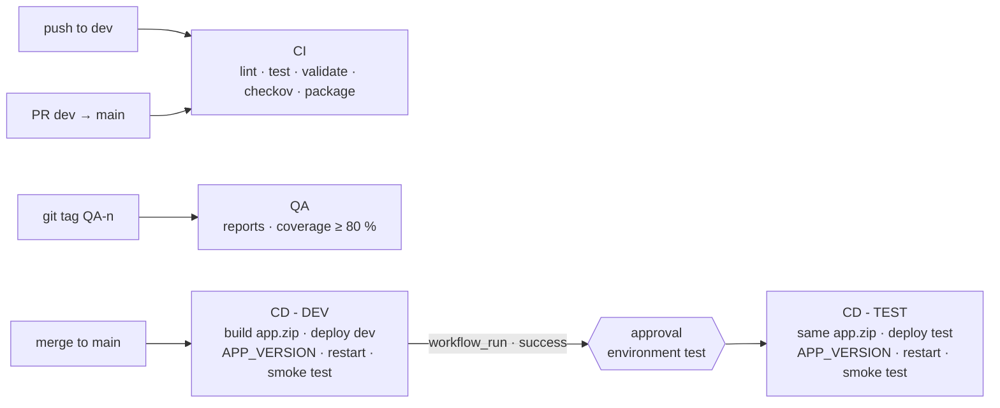

# 04 · CI/CD pipelines

*Step-by-step guide · `pipelines/` and `.github/workflows/` · Vojislav Stefanović · v1, 15.11.2026*

**What this is and why.** Four GitHub Actions workflows take a commit from a developer's branch to
the TEST environment with no manual steps except one deliberate approval. *CI* gives fast feedback
on every push, *QA* produces reports on demand, *CD - DEV* builds one immutable package and deploys
it to DEV, and *CD - TEST* promotes that same package after a reviewer approves. The principle is
**build once, promote the artifact**: TEST never rebuilds from source, so what was verified in DEV
is byte-for-byte what reaches TEST. The assignment prescribes the file names `ci.yml`, `qa.yml`,
`cd-dev.yml`, `cd-prod.yml` under `pipelines/`; GitHub only executes `.github/workflows/`, hence the
mirror rule in §2.

## 1. The four workflows

| File | Workflow name | Trigger | Jobs and gates | Environment |
|---|---|---|---|---|
| [ci.yml](../pipelines/ci.yml) | **CI** | push to `dev`; pull request to `main`; manual | `app-quality` (flake8, black, bandit, pytest + coverage, build `app.zip`), `infra-quality` (`terraform fmt`/`validate` for all three roots, Checkov ×2), `pipeline-sync-check` | none |
| [qa.yml](../pipelines/qa.yml) | **QA** | push of tag `QA` or `QA-*`; manual | `code-quality` (flake8 statistics, black diff, bandit report, pylint ≥ 8 — all in the job summary), `test-coverage` (`--cov-fail-under=80`, HTML report artifact) | none |
| [cd-dev.yml](../pipelines/cd-dev.yml) | **CD - DEV** | push to `main`; manual | `build` (pytest, `app.zip` artifact, 30-day retention) → `deploy-dev` (login, deploy, `APP_VERSION=<sha>`, restart, smoke test) | `dev` |
| [cd-prod.yml](../pipelines/cd-prod.yml) | **CD - TEST (promotion)** | `workflow_run` of *CD - DEV* on `main`, completed; manual with `run_id` | `promote-test`: `if: conclusion == 'success'` → **waits for the required reviewer** → downloads the *same* `app-package` from the DEV run → deploy, `APP_VERSION`, restart, smoke test | `test` |

> [!NOTE]
> The second required Azure environment in this assessment is TEST, so `cd-prod.yml` promotes
> DEV → TEST. A PROD stage would be one more job with `environment: prod` promoting the identical
> artifact again; nothing else changes.

### 1.1 Shared conventions

| Convention | Value | Description |
|---|---|---|
| Runner / Python | `ubuntu-latest`, 3.12 | Matches the App Service runtime |
| Actions | `actions/checkout@v4`, `setup-python@v5`, `upload/download-artifact@v4`, `azure/login@v2`, `azure/webapps-deploy@v3`, `hashicorp/setup-terraform@v3`, `bridgecrewio/checkov-action@v12` | Pinned to major versions |
| `concurrency` | group = workflow + ref | `cancel-in-progress: true` for CI/QA, **false** for both CD workflows |
| `permissions` | `contents: read` (+ `actions: read` in CD - TEST) | Needed to download an artifact from another run; no `id-token` because a service-principal secret is used |
| Package | `app.zip` = `app.py`, `requirements.txt`, `templates/`, `static/`, `README.md` | No venv, tests, caches or dev tooling; App Service runs `pip install` itself (`SCM_DO_BUILD_DURING_DEPLOYMENT=true`) |

## 2. The `pipelines/` ↔ `.github/workflows/` mirror

`pipelines/` is the source of truth required by the assignment; `.github/workflows/` holds
byte-identical copies because that is the only folder GitHub Actions reads.

### 2.1 Regenerate the copies after editing a workflow

```bash
scripts/sync-pipelines.sh
```

Copies `pipelines/*.yml` into `.github/workflows/` and prints each file copied.

### 2.2 Check for drift (what CI runs)

```bash
scripts/sync-pipelines.sh --check
```

Runs `diff -r` between the two folders (ignoring `README.md`) and exits 1 with an `::error::`
annotation if they differ — the `pipeline-sync-check` job in CI uses the same command.

## 3. Flow



CI and QA never deploy; only a merge to `main` moves code, and only a human moves it past DEV.

## 4. How to trigger each workflow

### 4.1 CI

```bash
git switch dev && git push origin dev
```

Any push to `dev` (or opening a PR into `main`) starts CI; all three jobs run in parallel and
finish in about 3 minutes.

### 4.2 QA

```bash
git tag QA-1 && git push origin QA-1
```

Pushing a tag named `QA` or `QA-*` starts QA; open the run's *Summary* tab to read the flake8,
black, bandit, pylint and coverage sections, and download the `coverage-report` artifact for HTML.

### 4.3 CD - DEV

```bash
gh pr create --base main --head dev --fill && gh pr merge --merge
```

Merging into `main` starts CD - DEV; the `deploy-dev` job's environment link opens
`https://dev.stefanovic-devops.xyz` directly from the run page.

### 4.4 CD - TEST

```bash
gh run list --workflow "CD - TEST (promotion)" --limit 1
gh run watch
```

After CD - DEV succeeds, a CD - TEST run appears in state *Waiting*; approve it under
*Actions → the run → Review deployments → test → Approve and deploy* (or via the API, see
[06-troubleshooting.md](06-troubleshooting.md) §9). Manual re-promotion of an older build:
`gh workflow run "CD - TEST (promotion)" -f run_id=<CD-DEV run id>`.

> [!WARNING]
> `workflow_run` triggers only fire for workflows that exist on the **default branch**. The first
> CD - DEV run on `main` did not trigger CD - TEST because `cd-prod.yml` had not been merged yet;
> every run after the merge chained correctly.

## 5. The smoke test

Both CD jobs end with [`scripts/smoke-test.sh <url> <env> <sha>`](../scripts/smoke-test.sh), run
after `az webapp config appsettings set APP_VERSION=<sha>` and `az webapp restart`.

| Phase | What it does | Pass condition | Budget |
|---|---|---|---|
| 1 · wait for rollout | polls `GET /health` | HTTP 200 **and** `version == <sha>` **and** `env == <env>` | 30 × 10 s |
| 2 · functional | `POST /transactions` then `GET /transactions`, each retried on non-2xx | 201 on create; the created description appears in the list | 5 × 5 s per request |

> [!WARNING]
> The very first CD - DEV run went red with `503` in phase 2. Changing an app setting restarts the
> container asynchronously, so the original script (which only checked `env`) tested the *old*
> container and then hit the restart. The fix was the explicit `az webapp restart` plus waiting for
> the **new version string** in `/health` — a response from the old container can no longer pass
> phase 1. Each CD run leaves one `smoke-test <sha>` row in the UI's transactions table, which is
> a convenient audit trail of deployments.

## 6. Reading results

| Where | What to look for | Description |
|---|---|---|
| *Actions → CI run → app-quality* | green steps, `pytest` line `10 passed`, coverage table | Unit tests and coverage |
| *Actions → CI run → infra-quality* | `Success! The configuration is valid.` ×3, Checkov `Failed checks: 0` | Infrastructure quality |
| *Actions → QA run → Summary* | sections per tool, pylint `rated at 10.00/10`, coverage table | Reports |
| *Actions → CD - DEV → deploy-dev → Smoke test* | `rollout complete`, `HTTP 201`, `Smoke test passed` | Deployment health |
| *Actions → CD - TEST* | *Waiting* badge, then reviewer name and timestamp in the job header | Approval gate |
| Deployed UI | version chip shows the short sha; newest table row is `smoke-test <sha>` | What is live |

## 7. Verification

- [ ] `scripts/sync-pipelines.sh --check` prints `OK: .github/workflows mirrors pipelines/`.
- [ ] `gh run list --limit 8` shows CI, QA, CD - DEV and CD - TEST all with `completed success`.
- [ ] The latest CD - TEST run's `promote-test` job shows *Approved by <you>* and downloaded `app-package` from the CD - DEV run id.
- [ ] `curl -s https://dev.stefanovic-devops.xyz/health | jq -r .version` equals the short sha of the latest commit on `main`; the same for `test` after approval.
- [ ] `GET /transactions` on each environment contains a `smoke-test <sha>` entry for that sha.
