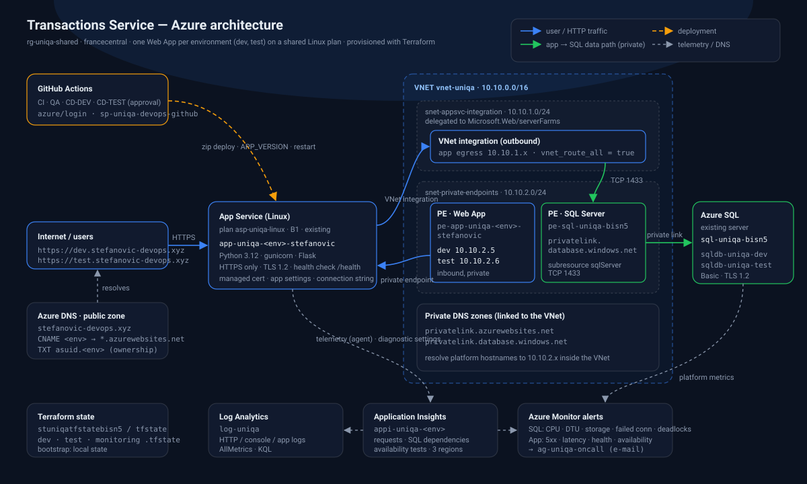
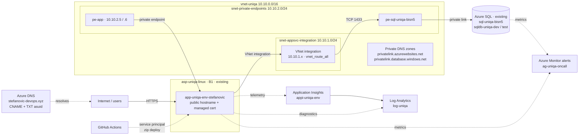
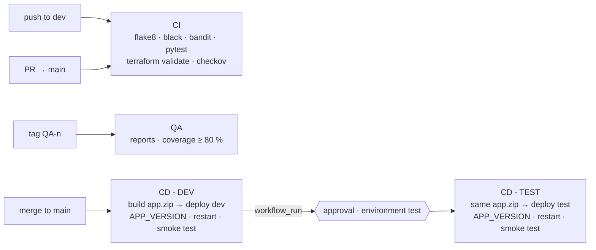

# Architecture

*Step-by-step guide · diagrams and component inventory · Vojislav Stefanović · v1, 15.11.2026*

**What this is and why.** One picture of how a request travels from a user's browser to the
database, and one of how a commit travels from a developer to the TEST environment. Both diagrams
below are kept deliberately simple; the exact names, addresses and thresholds live in the
inventory table (§3) and in the step-by-step guides.

## 1. Infrastructure

User traffic enters through the public hostname; the app's own traffic to SQL never leaves the VNet.

> [!NOTE]
> The Web App's private endpoint (10.10.2.x) is not on the user path in this assessment — public
> access is kept on so the reviewer and GitHub-hosted runners can reach the app. It is the ingress
> that an Application Gateway or a VNet-internal client would use in production.

## 2. CI/CD

The artifact built in CD - DEV is the only thing that reaches TEST; nothing is rebuilt after the gate.

## 3. Components

| Layer | Component | Name | Description |
|---|---|---|---|
| Shared | Resource group | `rg-uniqa-shared` | All resources, `francecentral` |
| Shared | App Service Plan | `asp-uniqa-linux` | Linux B1; the *existing* plan |
| Shared | Virtual network | `vnet-uniqa` 10.10.0.0/16 | Two subnets, see below |
| Shared | Subnet | `snet-appsvc-integration` 10.10.1.0/24 | Delegated to `Microsoft.Web/serverFarms`; outbound VNet integration |
| Shared | Subnet | `snet-private-endpoints` 10.10.2.0/24 | Private endpoints for the Web Apps and SQL |
| Shared | SQL Server | `sql-uniqa-bisn5` | The *existing* server; private endpoint `pe-sql-uniqa-bisn5`; firewall allows only the admin IP |
| Shared | Private DNS zones | `privatelink.azurewebsites.net`, `privatelink.database.windows.net` | Linked to the VNet |
| Shared | Public DNS zone | `stefanovic-devops.xyz` | Azure DNS; delegated from Namecheap |
| Shared | Log Analytics | `log-uniqa` | Diagnostics and App Insights workspace |
| Shared | State storage | `stuniqatfstatebisn5` / `tfstate` | `dev.tfstate`, `test.tfstate`, `monitoring.tfstate` |
| Environment | Web App | `app-uniqa-<env>-stefanovic` | Python 3.12, gunicorn, Flask; `https://<env>.stefanovic-devops.xyz` |
| Environment | SQL database | `sqldb-uniqa-<env>` | Basic, 2 GB |
| Environment | Private endpoint | `pe-app-uniqa-<env>-stefanovic` | dev 10.10.2.5, test 10.10.2.6 |
| Environment | Application Insights | `appi-uniqa-<env>` | Codeless agent; availability test `avail-<env>-health` |
| Environment | Custom domain | `<env>.stefanovic-devops.xyz` | TXT `asuid.<env>` + CNAME, managed certificate (SNI) |
| Environment | Secrets | `SECRET_KEY` (random_password), `TransactionsDb` connection string | Only in Terraform state and App Service settings |
| Monitoring | Action group | `ag-uniqa-oncall` | E-mail receiver, common alert schema |
| Monitoring | Metric alerts | `sql-<env>-*` (5), `app-<env>-*` (3), `avail-<env>-failed` | 18 rules total |
| Delivery | Service principal | `sp-uniqa-devops-github` | Contributor on the subscription; used by `azure/login` only |
| Delivery | Workflows | CI, QA, CD - DEV, CD - TEST (promotion) | `pipelines/` mirrored to `.github/workflows/` |

## 4. Verification

- [ ] `docs/img/architecture.svg` renders in the GitHub README (no external fonts or images).
- [ ] Every name in §3 matches `terraform state list` output of the corresponding root.
- [ ] The Mermaid blocks render on GitHub (flowchart syntax only).
