# Evidence

*Step-by-step guide · screenshot checklist · Vojislav Stefanović · v1, 15.11.2026*

**What this is and why.** Screenshots are the only proof that survives a teardown. Each file below
documents one claim made in the root README; the filenames are fixed so the images render here as
soon as they are added. Capture them from the real environments while they are running (before
[07-teardown.md](../07-teardown.md)).

## 1. Checklist

| # | File | Must show | Description |
|---|---|---|---|
| 01 | `01-app-ui-dev.png` | `https://dev.stefanovic-devops.xyz/` — env badge **dev**, version chip with a short sha, health pill green, request-path strip with SQL node green and latency, at least one `smoke-test <sha>` row | The deployed UI and the private app → SQL path |
| 02 | `02-resource-group.png` | Portal, `rg-uniqa-shared` resource list filtered to `uniqa` | All shared and per-environment resources in one place |
| 03 | `03-app-service-overview.png` | `app-uniqa-dev-stefanovic` → Overview: plan `asp-uniqa-linux (B1)`, custom domain, status Running | Web App on the existing plan |
| 04 | `04-private-endpoint.png` | `pe-app-uniqa-dev-stefanovic` → DNS configuration: IP 10.10.2.5, zone `privatelink.azurewebsites.net` | Inbound private endpoint |
| 05 | `05-vnet-integration.png` | Web App → Networking → VNet integration: `vnet-uniqa / snet-appsvc-integration`, *Route all* enabled | Outbound VNet integration |
| 06 | `06-custom-domain-tls.png` | Web App → Custom domains: `dev.stefanovic-devops.xyz` with managed certificate, SNI SSL, *Secure* | Custom domain and TLS |
| 07 | `07-actions-all-green.png` | GitHub → Actions: latest CI, QA, CD - DEV and CD - TEST runs all green | Pipelines working end to end |
| 08 | `08-cd-test-approval.png` | CD - TEST run: *Review deployments* dialog or the job header "Approved by …" | Manual approval gate |
| 09 | `09-app-insights.png` | `appi-uniqa-dev` → Availability (3 locations green) or Performance with SQL dependency | Telemetry and availability |
| 10 | `10-alert-rules.png` | Monitor → Alerts → Alert rules filtered to `rg-uniqa-shared`: 18 rules | Monitoring of the existing SQL Server and apps |
| 11 | `11-terraform-apply.png` | Terminal: `terraform apply` of the application root ending in `Apply complete!` with the outputs | Infrastructure as code applied |

> [!TIP]
> Before capturing 03 and 11, hide values: in the portal use *Configuration → Hide values*, and in
> the terminal run `terraform output` without `-raw` so `sql_admin_password` and
> `application_insights_connection_string` print as `<sensitive>`.

## 2. Images

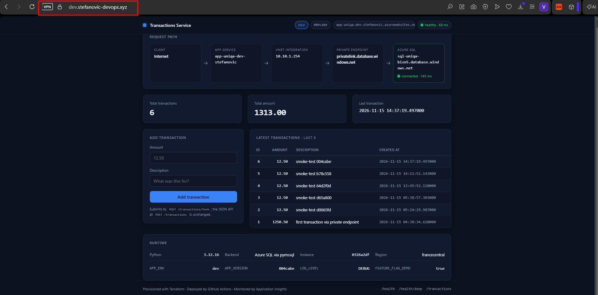

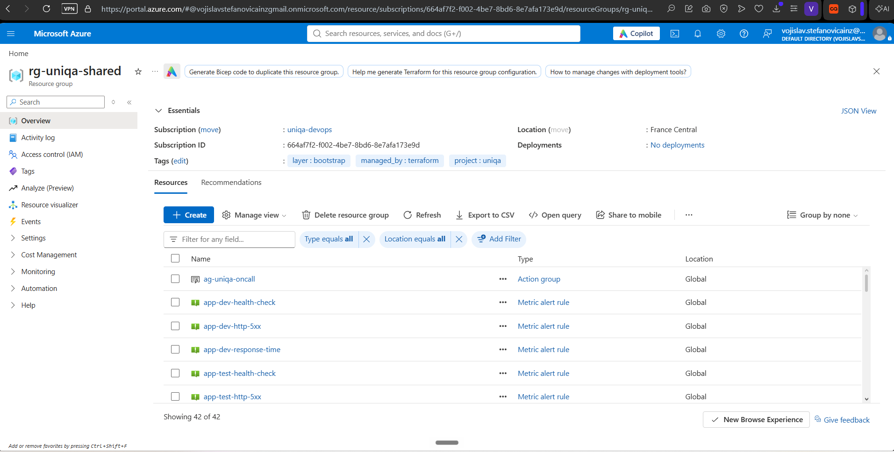

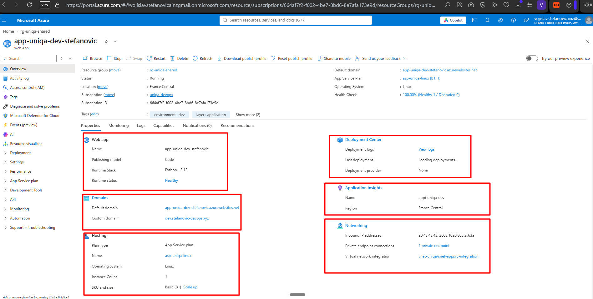

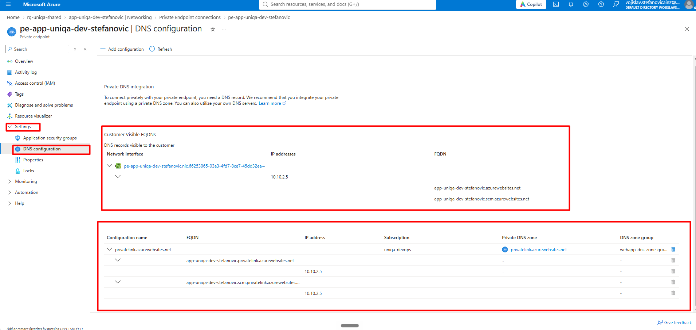

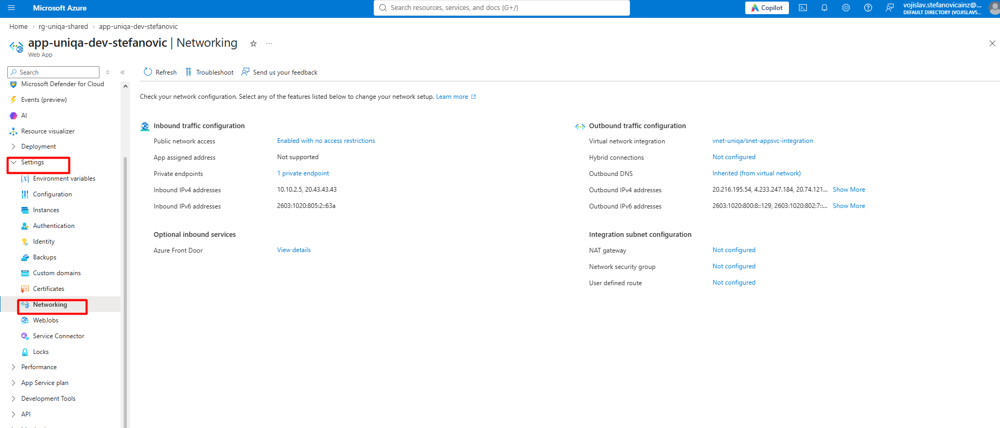

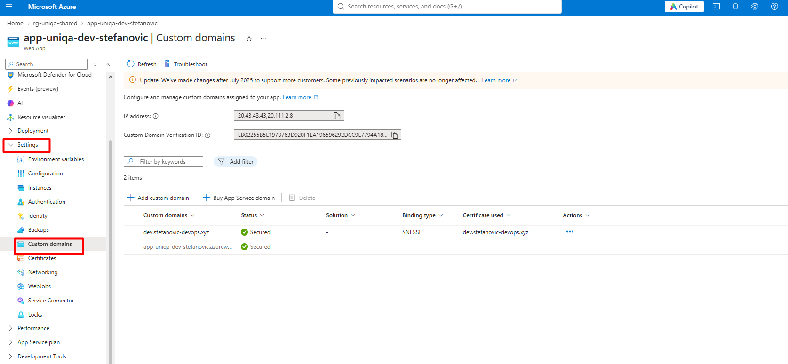

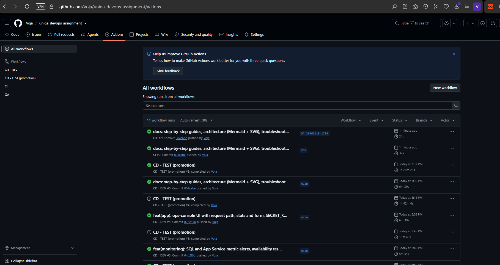

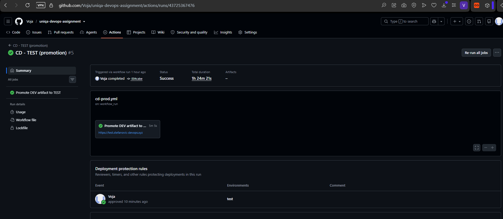

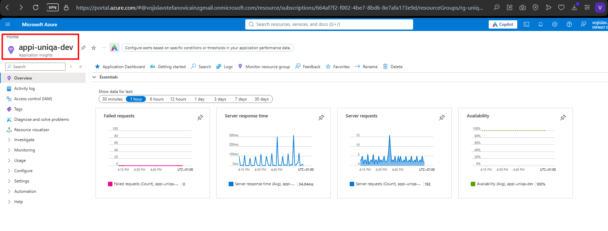

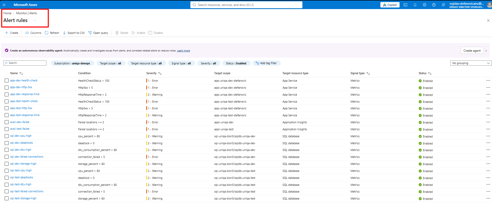

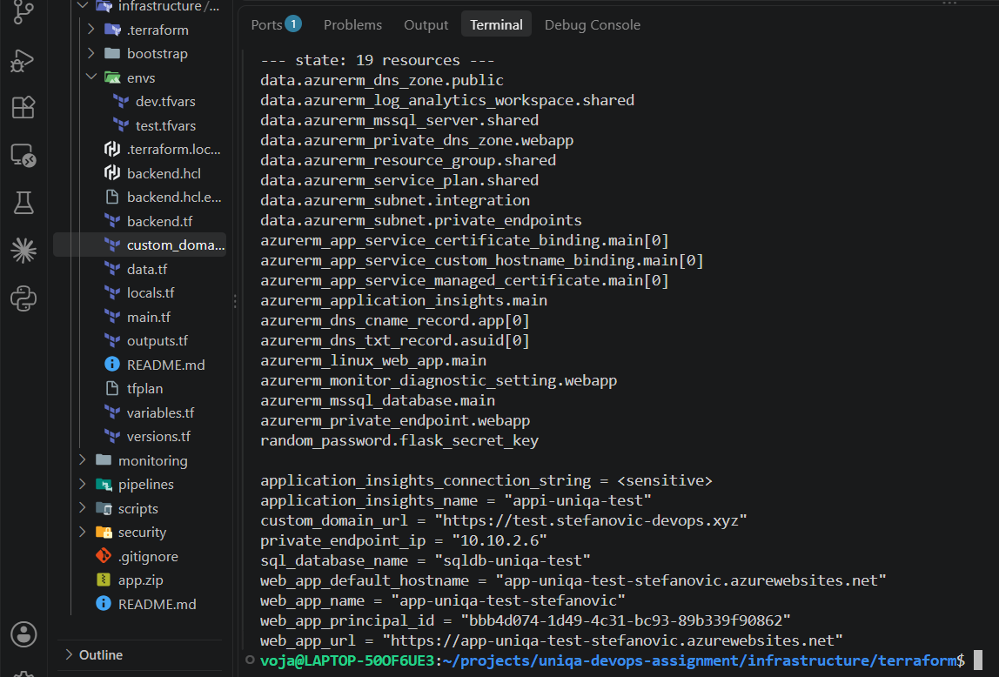

## 3. Verification

- [ ] All eleven files exist in `docs/evidence/` with exactly the names above (`ls docs/evidence/*.png | wc -l` → 11).
- [ ] Each image renders in this README on GitHub.
- [ ] No screenshot shows a secret (connection string values, `SECRET_KEY`, service-principal JSON).
